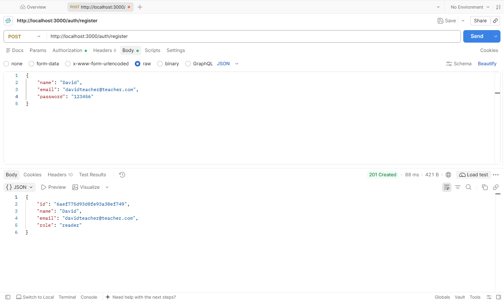
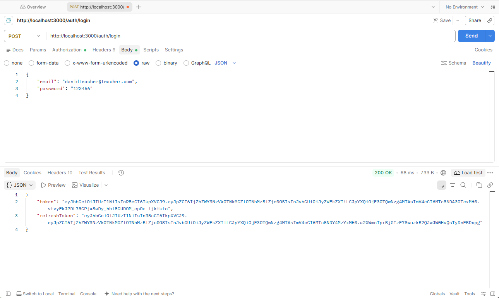
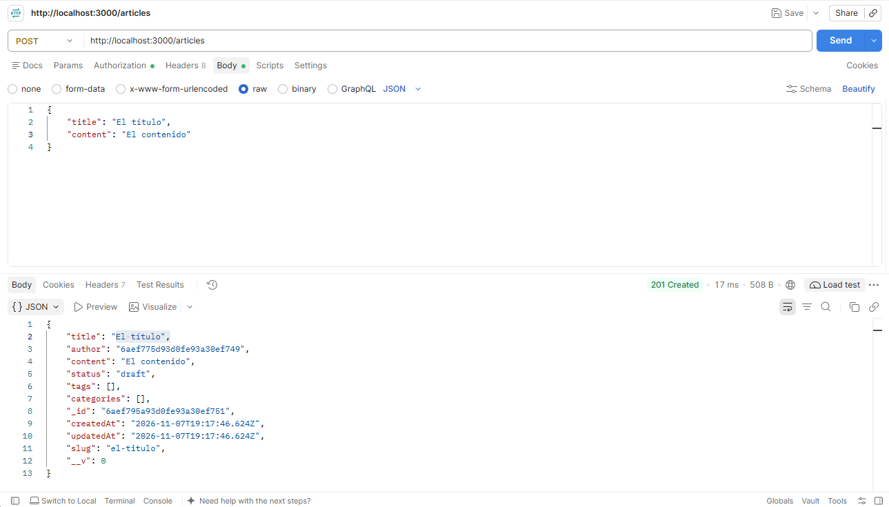
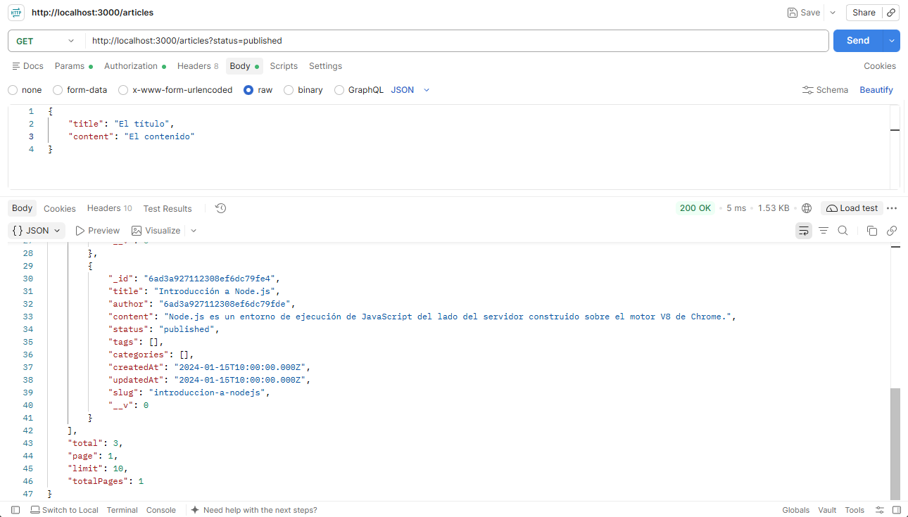
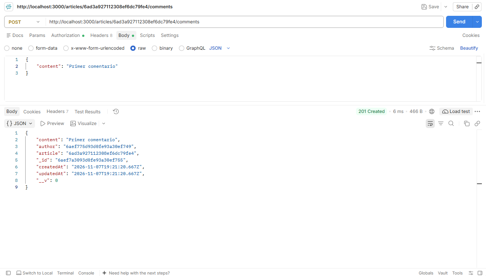
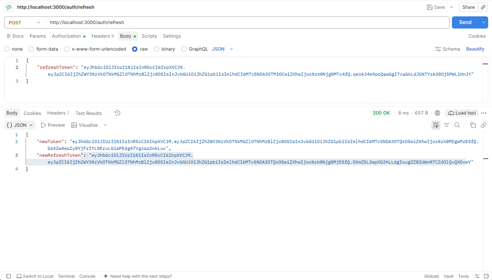
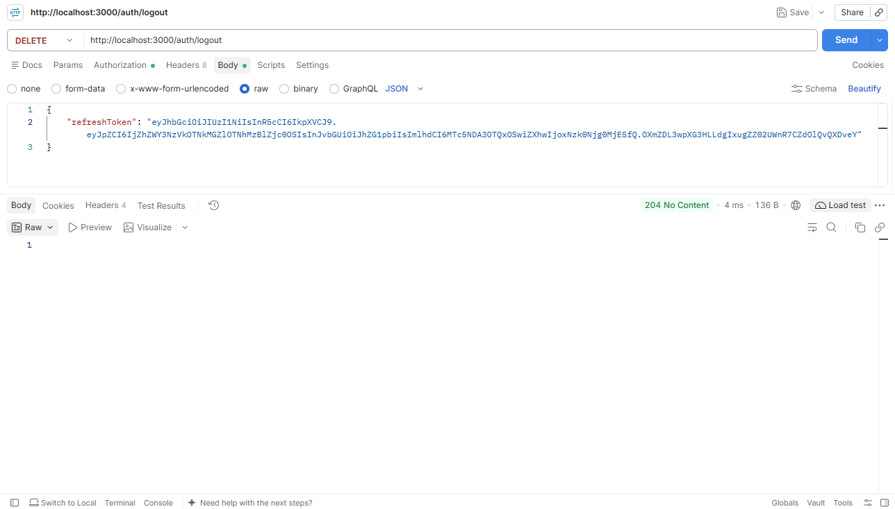

# 🚀 API REST — CMS Blog | MongoDB · Express · Node.js

> API REST production-ready para un sistema de gestión de contenidos (CMS) de blog.

## 🗄️ Decisión de base de datos

He usado **MongoDB** con Mongoose por estas razones:

- 🧩 La flexibilidad a la hora de crear modelos, añadir campos posteriormente sin romper los datos existentes.
- 💡 Los datos, al ser prácticamente objetos de JavaScript (artículos, usuarios, comentarios), guardarlos como JSON encaja a la manera de estar practicando anteriormente y resulta más intuituvo.
- 🛠️ Mongoose resulta de mucha ayuda porque puedes definir el esquema y las validaciones en el mismo sitio que el resto del código JS, y tiene cosas muy útiles como los hooks pre-save (generar el slug automáticamente por ejemplo).
- 🧠 Con MySql hay que estar cambiando mentalmente entre la sintaxis de javascript y la de MySql, sin embargo con mongoDB es todo puramente javascript. Eso ayuda a tener un flujo mental mas fácil de seguir.

## ⚙️ Instalación y arranque

### 📋 Requisitos previos

- Node.js 18+
- Docker Desktop

### 🪜 Pasos

```bash
# 1. Clona el repositorio
git clone <url-del-repositorio>
cd 14-api-final-project

# 2. Instala las dependencias
npm install

# 3. Crea el archivo de variables de entorno
cp .env.example .env
# Rellena los valores en .env

# 4. Arranca la app (levanta MongoDB con Docker y el servidor)
npm run dev
```

> [!IMPORTANT]
> 🔒 Nunca subas el archivo `.env` al repositorio. Usa `.env.example` como plantilla sin valores reales.

### 🧪 Tests

```bash
npm test
```

> [!NOTE]
> 🐳 Para correr los tests necesitas tener Docker Desktop arrancado y haber ejecutado `npm run dev` previamente para que MongoDB esté disponible.

> [!IMPORTANT]
> ⚡ La API tiene rate limit activo (10 peticiones cada 15 min en rutas de auth, 100 en rutas públicas). Si los tests fallan por ese motivo, puedes añadir `skip: () => process.env.NODE_ENV === "test"` en cada `rateLimit()` de `src/middlewares/rateLimit.js` y ejecutar los test con normalidad (npm test).

## 📡 Endpoints

### 🔐 Auth

| Método | Ruta           | Auth | Descripción                                          |
| ------ | -------------- | ---- | ---------------------------------------------------- |
| POST   | /auth/register | No   | Registra un nuevo usuario                            |
| POST   | /auth/login    | No   | Inicia sesión, devuelve access token y refresh token |
| POST   | /auth/refresh  | No   | Renueva el access token usando el refresh token      |
| DELETE | /auth/logout   | No   | Elimina el refresh token                             |

> [!TIP]
> ⏱️ El access token expira en 15 minutos. Usa el refresh token (válido 7 días) para obtener uno nuevo sin volver a hacer login.

### 📝 Artículos

| Método | Ruta          | Auth                  | Descripción                                           |
| ------ | ------------- | --------------------- | ----------------------------------------------------- |
| GET    | /articles     | No                    | Lista artículos publicados (con filtros y paginación) |
| GET    | /articles/:id | No                    | Obtiene un artículo por id                            |
| POST   | /articles     | admin, editor         | Crea un artículo                                      |
| PATCH  | /articles/:id | Autor, admin o editor | Actualiza parcialmente un artículo                    |
| PUT    | /articles/:id | Autor, admin o editor | Reemplaza un artículo completo                        |
| DELETE | /articles/:id | Autor, admin o editor | Elimina un artículo                                   |

**🔍 Filtros disponibles en GET /articles:**

```
?status=published&category=<id>&author=<id>&q=texto&page=1&limit=10&sort=createdAt&populate=author
```

### 🏷️ Categorías

| Método | Ruta            | Auth          | Descripción                  |
| ------ | --------------- | ------------- | ---------------------------- |
| GET    | /categories     | No            | Lista todas las categorías   |
| GET    | /categories/:id | No            | Obtiene una categoría por id |
| POST   | /categories     | admin, editor | Crea una categoría           |
| PATCH  | /categories/:id | admin, editor | Actualiza una categoría      |
| DELETE | /categories/:id | admin, editor | Elimina una categoría        |

### 💬 Comentarios

| Método | Ruta                              | Auth                         | Descripción                          |
| ------ | --------------------------------- | ---------------------------- | ------------------------------------ |
| GET    | /articles/:id/comments            | No                           | Lista los comentarios de un artículo |
| POST   | /articles/:id/comments            | Autenticado                  | Crea un comentario en un artículo    |
| DELETE | /articles/:id/comments/:commentId | Autor del comentario o admin | Elimina un comentario                |

> [!WARNING]
> 🛡️ Los endpoints de creación, edición y borrado requieren un Bearer token válido en la cabecera `Authorization`. Sin él se devuelve un `401`.

## 📸 Ejemplos de requests

> [!NOTE]
> 📷 Las siguientes capturas muestran los principales flujos desde Postman.

### 📝 Registro



### 🔑 Login



### ✍️ Crear artículo



### 📋 Listar artículos con filtros



### 💬 Crear comentario



### 🔄 Refresh token



### 🚪 Logout


